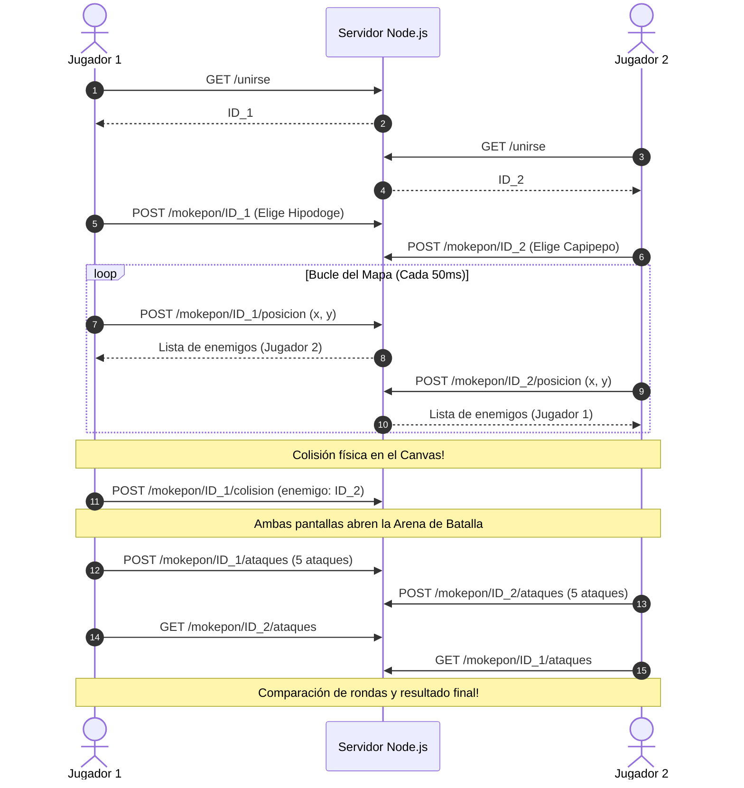

# ⚡ MOKEPON! - Juego de Batalla Multijugador en Tiempo Real 🎮

Bienvenido a **MOKEPON!**, un juego interactivo de combate elemental multijugador desarrollado en **JavaScript**, **Node.js** y **Express**, donde los jugadores eligen a su mascota favorita, recorren un mapa interactivo renderizado en **Canvas HTML5** en tiempo real y, al colisionar con otro jugador, entran automáticamente en una emocionante **Arena de Combate por turnos**.

Link del usuario de platzi: https://platzi.com/p/jonmarcet/

---

## 📌 Tabla de Contenidos
- [Características Principales](#-características-principales)
- [Mascotas y Elementos](#-mascotas-y-elementos)
- [Reglas de Combate](#-reglas-de-combate)
- [Lenguajes y Tecnologías Utilizadas](#-lenguajes-y-tecnologías-utilizadas)
- [Arquitectura y Cómo Funciona el Multijugador](#-arquitectura-y-cómo-funciona-el-multijugador)
- [Estructura del Proyecto](#-estructura-del-proyecto)
- [Instalación y Ejecución Local](#-instalación-y-ejecución-local)
- [Cómo Jugar en Multijugador](#-cómo-jugar-en-multijugador)
- [Autor](#-autor)

---

## 🚀 Características Principales

- **Multijugador en Tiempo Real**: Soporte completo para jugadores simultáneos en `localhost` o red local (LAN).
- **Mapa Interactivo con Canvas 2D**: Visualización fluida de los personajes en movimiento con nombres y roles diferenciados (`Tú` vs `Rival`).
- **Detección Geométrica de Colisiones (AABB)**: Al tocar físicamente al personaje rival en el mapa, ambas pantallas cambian inmediatamente a la pantalla de combate.
- **Diseño Ultra Moderno (Glassmorphism & Gaming UI)**:
  - Paleta de colores oscura cósmica con orbes de resplandor ambiental.
  - Tarjetas coleccionables con efectos 3D y temática según el elemento.
  - Cruceta arcade (D-Pad) ergonómica y atajos con teclado (flechas direccionales).
  - Arena versus con indicadores de vidas/victorias e historial de ataques animados.
- **Backend Robusto y Limpieza Automática**: Manejo de eventos con Express, endpoints REST y depuración de jugadores inactivos.

---

## 🐾 Mascotas y Elementos

Cada Mokepon cuenta con su propio elemento, diseño y ataques especializados:

| Mascota | Elemento | Ataques Fuertes | Descripción |
| :---: | :---: | :---: | :--- |
| **Hipodoge** | 💧 **Agua** | 💧 💧 💧 🔥 🌱 | Domina los torrentes de agua. Fuerte contra fuego. |
| **Capipepo** | 🌱 **Tierra** | 🌱 🌱 🌱 💧 🔥 | Protector de la naturaleza y rocas. Fuerte contra agua. |
| **Ratigueya** | 🔥 **Fuego** | 🔥 🔥 🔥 💧 🌱 | Rápido y ardiente como las llamas. Fuerte contra tierra. |

---

## ⚔️ Reglas de Combate

El sistema de combate está basado en el clásico triángulo de fortalezas elementales:

```
        🔥 FUEGO
       ↗         ↘
   Vence         Vence
     /             \
🌱 TIERRA  ↖ Vence 💧 AGUA
```

- 🔥 **FUEGO** vence a 🌱 **TIERRA**.
- 💧 **AGUA** vence a 🔥 **FUEGO**.
- 🌱 **TIERRA** vence a 💧 **AGUA**.
- Si ambos jugadores eligen el mismo elemento en la ronda, es un **EMPATE ⚖️**.

Cada jugador selecciona una secuencia de **5 ataques**. Una vez que ambos han enviado sus movimientos, el sistema compara cada ronda, otorga puntos de victoria y determina al ganador definitivo.

---

## 💻 Lenguajes y Tecnologías Utilizadas

### 1. **HTML5 (Estructura Semántica)**
- Etiquetas semánticas (`<header>`, `<main>`, `<section>`, `<canvas>`).
- Canvas API para el renderizado del mapa, fondos, sprites y píldoras de nombres.
- Formularios interactivos accesibles con `<input type="radio">` y `<label>`.

### 2. **CSS3 (Estilos y Diseño Avanzado)**
- **Variables CSS (Tokens de Diseño)** para paleta de colores y resplandores temáticos.
- **Efectos Glassmorphism**: `backdrop-filter: blur()`, fondos translúcidos y bordes reflectantes.
- **Animaciones Keyframe**: `pulseRotate`, `pulseScale`, `slideInUp` para efectos de combate dinámicos.
- **Diseño Totalmente Responsivo**: Sistema mixto de CSS Grid y Flexbox adaptable a computadores y dispositivos móviles.

### 3. **JavaScript Vanilla (ES6+ - Frontend)**
- **Programación Orientada a Objetos (POO)**: Clases `Mokepon` con métodos como `pintarMokepon()`.
- **Fetch API (Asíncrono con Promesas)** para comunicación continua con el servidor backend.
- **Canvas 2D Context**: Renderizado de sprites, sombras dinámicas con `ellipse()`, y etiquetas redondeadas con `roundRect()`.
- **Detección de Colisiones AABB**: Algoritmo de intersección de cajas alineadas a los ejes para disparar el combate.
- **Event Listeners**: Manejo de teclado (`ArrowUp`, `ArrowDown`, `ArrowLeft`, `ArrowRight`) y eventos táctiles/mouse (`mousedown`, `mouseup`, `touchstart`, `touchend`).

### 4. **Node.js & Express.js (Backend)**
- **Servidor HTTP Express**: Servidor ligero corriendo en el puerto `8080`.
- **API RESTful**:
  - `GET /unirse`: Registra a un nuevo jugador y genera un identificador único.
  - `POST /mokepon/:jugadorId`: Asocia la mascota seleccionada al jugador.
  - `POST /mokepon/:jugadorId/posicion`: Actualiza coordenadas `x, y` y retorna la lista de enemigos activos.
  - `POST /mokepon/:jugadorId/colision`: Notifica y sincroniza el estado de combate bidireccional entre rivales.
  - `POST /mokepon/:jugadorId/ataques`: Recibe la lista de 5 ataques del jugador.
  - `GET /mokepon/:jugadorId/ataques`: Permite al rival consultar y resolver los ataques enviados.
- **CORS (`cors`)**: Habilita la conexión segura entre diferentes pestañas, direcciones IP o puertos en red local.
- **Servicio de Archivos Estáticos**: `express.static(__dirname)` para servir la aplicación web directamente desde la raíz.

---

## 🏗️ Arquitectura y Cómo Funciona el Multijugador



---

## 📁 Estructura del Proyecto

```text
mokepon/
├── assets/                                  # Sprites e imágenes del juego
│   ├── capipepo.png                         # Avatar mapa Capipepo
│   ├── hipodoge.png                         # Avatar mapa Hipodoge
│   ├── ratigueya.png                        # Avatar mapa Ratigueya
│   ├── mokemap.png                          # Fondo del mapa
│   ├── mokepons_mokepon_capipepo_attack.png # Tarjeta Capipepo
│   ├── mokepons_mokepon_hipodoge_attack.png # Tarjeta Hipodoge
│   └── mokepons_mokepon_ratigueya_attack.png# Tarjeta Ratigueya
├── js/
│   └── mokepon.js                           # Lógica del cliente, canvas y batalla
├── index.js                                 # Servidor backend Node.js + Express
├── mokepon.html                             # Estructura semántica de la aplicación
├── styles.css                               # Estilos modernos y animaciones
├── package.json                             # Configuración y dependencias del proyecto
├── .gitignore                               # Exclusiones de Git (node_modules, logs)
└── README.md                                # Documentación completa del proyecto
```

---

## ⚙️ Instalación y Ejecución Local

### Prerrequisitos
- Tener instalado [Node.js](https://nodejs.org/) (versión 16 o superior).
- Un navegador web moderno (Google Chrome, Firefox, Edge, etc.).

### Pasos

1. **Clonar el repositorio**:
   ```bash
   git clone https://github.com/Jonathan-stack23/Curso.git
   cd Curso/mokepon
   ```

2. **Instalar dependencias**:
   ```bash
   npm install
   ```

3. **Iniciar el servidor**:
   ```bash
   npm start
   ```
   *O alternativamente:*
   ```bash
   node index.js
   ```

4. **Acceder al juego**:
   Abre tu navegador e ingresa a:
   ```text
   http://localhost:8080
   ```

---

## 👥 Cómo Jugar en Multijugador

1. Abre **[http://localhost:8080](http://localhost:8080)** en una pestaña del navegador (Jugador 1).
2. Abre otra pestaña o ventana de incógnito en **[http://localhost:8080](http://localhost:8080)** (Jugador 2).
3. Cada jugador selecciona una mascota diferente (ejemplo: *Hipodoge* y *Ratigueya*) y pulsa **"Entrar al Mapa"**.
4. Ambos jugadores aparecerán en el mapa y verán sus movimientos en tiempo real.
5. Muévete con las **flechas del teclado** o la **cruceta táctil** en pantalla.
6. Al tocar al rival, **ambas pantallas cambiarán automáticamente a la Arena de Batalla**.
7. Selecciona tus 5 ataques y compite para ver quién se corona como el campeón Mokepon.

---

## 👤 Autor

Desarrollado y mantenido por:
- **Jonathan Josué Martínez Cetina**
- GitHub: [@Jonathan-stack23](https://github.com/Jonathan-stack23)
